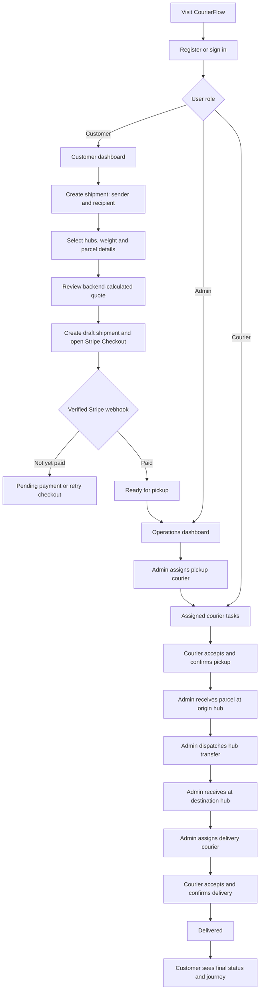
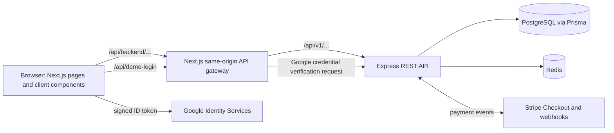

# CourierFlow - Courier & Logistics Management Frontend

A role-based courier management application built with **Next.js 16, React 19, and TypeScript**. CourierFlow connects customers, couriers, and operations administrators in one shipment lifecycle: booking, server-calculated pricing, Stripe Checkout, pickup, hub transfers, delivery, and tracking.

> ** project:** Demo access is available for evaluating the three roles. Demo sessions use real application accounts and backend data, not mocked dashboard records. Use a dedicated test environment; do not enable public one-click Admin access against production or sensitive data.

## Live Application and Repositories

| Resource | URL |
| --- | --- |
| Frontend | [courier-logistic-management-fronten.vercel.app](https://courier-logistic-management-fronten.vercel.app/) |
| Frontend repository | [courier-logistic-management-Frontend](https://github.com/Rezwanul777/courier-logistic-management-Frontend) |
| Backend repository | [courier-logistic-management](https://github.com/Rezwanul777/courier-logistic-management) |
| Deployed backend API | [`https://coureir-logistic.vercel.app/api/v1`](https://coureir-logistic.vercel.app/api/v1) |

The frontend and backend are **separate deployments**. The frontend does not connect directly to PostgreSQL. Its server-side API gateway communicates with the Express REST API, which owns authentication, business rules, database access, courier operations, and payment verification.

## What the Application Does

| Role | Primary capabilities |
| --- | --- |
| **Customer** | Register and verify email, sign in (password or Google for eligible accounts), book shipments, request a quote, pay with Stripe, review payment history, and follow tracking milestones. |
| **Courier** | View assigned pickup/delivery tasks, accept assignments, confirm pickup with a note, confirm delivery with recipient information and proof, and review completed tasks. |
| **Admin** | Monitor operations, manage shipments/couriers/users, assign pickups and deliveries, receive and dispatch hub transfers, manage hubs/zones/rate cards, and inspect saved audit events. |

Role-specific routes are protected. Google Sign-In is implemented for **Customer** accounts only; Admin and Courier use credential-based sign-in.

## End-to-End Workflow



### 1. Customer Journey

1. Open the homepage. Explore **Services**, **Pricing**, and **Contact**, or select **Create a shipment**. The homepage tracking-code form currently directs users to sign in; tracking details are available in the authenticated customer workspace.
2. Select **Sign in** or **Create an account**. New password-based customers register and complete email-code verification. The Customer Google button submits a Google ID token for backend verification. Existing password accounts are **not automatically linked** to Google solely by matching email.
3. Open **Customer Overview** (`/customer`) to see shipment totals, latest tracking information, and recent shipments.
4. Select **Create shipment** (`/customer/shipments/new`). Complete the three-stage booking wizard:
   - **Pickup & recipient:** sender/recipient names and phone numbers, collection address/city, delivery address/city.
   - **Parcel & route:** origin hub, destination hub, weight in kilograms, optional description. The hubs must be different.
   - **Review & pay:** verify the details and inspect a server-calculated shipping quote based on the applicable rate card.
5. Select **Continue to Stripe**. CourierFlow saves a **draft shipment**, then requests a Stripe Checkout session. If Checkout fails after draft creation, the UI can retry payment for the existing shipment instead of blindly creating a duplicate.
6. Complete payment in Stripe Checkout (use **Stripe test mode** for assignment demonstrations). Returning to `/payment/success` does **not** by itself prove payment succeeded: the interface checks the backend's payment status, which is confirmed by Stripe webhook processing.
7. After verified payment, the shipment becomes ready for pickup. Review **My shipments** (`/customer/shipments`), open its details (`/customer/shipments/[id]`), and follow the shipment timeline.
8. Visit **Payments** (`/customer/payments`) to review transaction records and payment status. Pending or unsuccessful payments can be revisited through the available payment actions.
9. Once the courier completes the handover, the shipment shows **DELIVERED**, and the customer can review the completed tracking history.

### 2. Admin Operations Journey

1. Sign in as an Admin and open `/admin` for operational metrics, recently booked shipments, and items needing attention.
2. Go to **Shipments** (`/admin/shipments`) and open a paid shipment's details (`/admin/shipments/[id]`).
3. When its status is `READY_FOR_PICKUP` and payment is `PAID`, **assign a pickup courier**.
4. After the courier confirms collection, **receive the parcel at its origin hub**.
5. **Dispatch the transfer** from origin hub to destination hub, then **confirm receipt at the destination hub**.
6. When status is `AT_DESTINATION_HUB` and payment is `PAID`, **assign a delivery courier**.
7. Monitor the courier's delivery completion and the shipment's tracking timeline.
8. Use the supporting management screens as needed:
   - **Couriers:** view/create courier accounts and manage availability/status.
   - **Hubs & zones:** manage service areas and hub records.
   - **Rate cards:** manage prices by zone pair and weight range; changes govern future quotations.
   - **Users:** search accounts, inspect details, and perform permitted account actions with a reason.
   - **Audit logs:** inspect events that the backend has actually recorded. Not every operation necessarily creates an audit entry.

### 3. Courier Journey

1. Sign in as a Courier and open **My Tasks** (`/courier`). Filter tasks by Pickup or Delivery.
2. Open an assigned pickup task at `/courier/tasks/[id]`, review the sender and parcel information, and select **Accept pickup task**.
3. After collecting the parcel, enter a **pickup confirmation note** and select **Confirm parcel pickup**. The shipment's progress is recorded.
4. Later, after Admin hub processing and delivery assignment, open the delivery task and select **Accept delivery task**.
5. After handing over the parcel, provide the **recipient name** and **proof-of-delivery note**; select **Confirm parcel delivery**.
6. Review completed work at **Task History** (`/courier/history`).

### Shipment Status Lifecycle

| Order | Shipment status | Trigger / responsible role |
| --- | --- | --- |
| 1 | `DRAFT` | Customer submits a shipment booking; payment remains unconfirmed. |
| 2 | `READY_FOR_PICKUP` | Backend confirms payment after Stripe webhook verification. |
| 3 | `PICKUP_ASSIGNED` | Admin assigns a pickup courier. |
| 4 | `PICKED_UP` | Courier confirms parcel collection. |
| 5 | `AT_ORIGIN_HUB` | Admin confirms receipt at the origin hub. |
| 6 | `IN_TRANSIT` | Admin dispatches the hub transfer. |
| 7 | `AT_DESTINATION_HUB` | Admin confirms arrival at the destination hub. |
| 8 | `OUT_FOR_DELIVERY` | Admin assigns delivery to a courier. |
| 9 | `DELIVERED` | Courier records recipient and delivery proof. |

These are the **happy-path** statuses. The backend also enforces its permitted transitions and may record cancellation or failure states when relevant. Do not manually change shipment statuses in the frontend or database to simulate progress.

## Technology Stack

| Layer | Technology |
| --- | --- |
| Web framework | Next.js 16 (App Router) |
| Language | TypeScript |
| UI | React 19, Tailwind CSS 4, shadcn/Base UI components |
| Forms and input validation | TanStack Form, Zod |
| Client-side server state | TanStack Query |
| HTTP client | `ofetch` and native `fetch` |
| Notifications | Sonner |
| Icons | Lucide React |
| Authentication | Server-managed HttpOnly cookies, backend JWT/refresh sessions, Google Identity Services for customers |
| Checkout | Stripe-hosted Checkout; verification performed by the backend webhook |
| Backend | Express 5, Prisma 7, PostgreSQL, Redis (separate repository) |
| Hosting | Vercel (frontend and backend as distinct projects) |
| Formatting / linting | Biome |

## Architecture



**Important implementation decisions:**

- Browser API calls use the same-origin `/api/backend` gateway instead of directly sending authentication cookies across domains.
- `src/lib/backend-policy.ts` provides a backend endpoint/method allowlist, origin checks for mutations, approved-cookie forwarding, cookie-path rewriting, and auth-token response stripping.
- Session-sensitive Server Components read cookies on the server. Private data loaders use `cache: "no-store"`.
- Route-specific UI authorization complements, but does **not replace**, the backend's role-based authorization.
- Shipping quotes and payment status are determined server-side. A Stripe success-page redirect is not treated as payment proof.

### Repository Structure (selected)

```text
src/
├── app/
│   ├── page.tsx                         # Public homepage
│   ├── (auth)/                          # Login, registration, OTP, reset
│   ├── (protected)/
│   │   ├── account/
│   │   ├── customer/                    # Overview, shipments, payments
│   │   ├── courier/                     # Assigned tasks and history
│   │   ├── admin/                       # Operations and management
│   │   └── payment/                     # Checkout return / payment list
│   └── api/
│       ├── backend/[...path]/route.ts  # Allowlisted API gateway
│       └── demo-login/route.ts         # Opt-in assignment demo login
├── component/
│   ├── auth/                            # Login, registration, Google, demo
│   ├── customer/                        # Shipment wizard and payment UI
│   ├── courier/                         # Pickup/delivery actions
│   ├── admin/                           # Operational forms and tables
│   ├── dashboard/                       # Role-based navigation and shell
│   └── layout/                          # Public header/footer and branding
├── lib/
│   ├── server/                          # Server-side authenticated loaders
│   ├── auth-api.ts                      # Browser auth requests
│   ├── apiClient.ts                     # Same-origin browser HTTP client
│   ├── backend-policy.ts                # Proxy and cookie safeguards
│   ├── env.ts                           # Runtime configuration validation
│   ├── shipment-quote.ts                # Shipping quotes
│   ├── shipment-checkout.ts             # Booking and Stripe Checkout
│   └── shipment-draft.schema.ts         # Booking form validation
└── providers/                           # Query and app providers
```

## Application Routes

| Route | Role / purpose |
| --- | --- |
| `/` | Public landing page |
| `/about`, `/services`, `/pricing`, `/contact` | Public informational pages |
| `/login`, `/register`, `/verify-email`, `/forgot-password` | Public authentication pages |
| `/customer` | Customer dashboard |
| `/customer/shipments/new` | Three-step shipment creation |
| `/customer/shipments` | Shipment directory and filters |
| `/customer/shipments/[id]` | Shipment detail and tracking timeline |
| `/customer/payments` | Customer payment history |
| `/payment`, `/payment/success`, `/payment/cancel` | Payment listing and Stripe return handling |
| `/courier`, `/courier/tasks/[id]`, `/courier/history` | Courier task dashboard, task detail, completion history |
| `/admin`, `/admin/shipments`, `/admin/shipments/[id]` | Admin overview and shipment operations |
| `/admin/couriers`, `/admin/users`, `/admin/users/[id]` | Account and courier management |
| `/admin/hubs`, `/admin/hubs/zones`, `/admin/rates` | Hub, zone, and pricing management |
| `/admin/audit-logs` | Read-only audit history viewer |
| `/account` | Signed-in account overview / logout |

Bracketed route segments (such as `[id]`) are dynamic. Access is restricted by authenticated role.

## Run Locally

### Prerequisites

- Node.js **22.x** recommended and npm.
- A running instance of the [CourierFlow backend](https://github.com/Rezwanul777/courier-logistic-management) with its database, Redis, Stripe and other required backend configuration.
- A Google OAuth 2.0 **Web application** Client ID only if testing Google Sign-In.

```bash
git clone https://github.com/Rezwanul777/courier-logistic-management-Frontend.git
cd courier-logistic-management-Frontend
npm install
```

Create **`.env.local`** in the frontend repository root (beside `package.json`):

```dotenv
# Required: upstream Express API, including /api/v1
BACKEND_API_URL=http://localhost:5000/api/v1

# Required frontend origin; must match the browser address
APP_URL=http://localhost:3000

# Optional unless testing Google Sign-In
NEXT_PUBLIC_GOOGLE_CLIENT_ID=YOUR_GOOGLE_WEB_CLIENT_ID.apps.googleusercontent.com

# Optional: assignment-only demo login
DEMO_LOGIN_ENABLED=false
DEMO_CUSTOMER_EMAIL=
DEMO_CUSTOMER_PASSWORD=
DEMO_COURIER_EMAIL=
DEMO_COURIER_PASSWORD=
DEMO_ADMIN_EMAIL=
DEMO_ADMIN_PASSWORD=
```

`BACKEND_API_URL` must end in `/api/v1`. The frontend's `src/lib/env.ts` validates both `BACKEND_API_URL` and `APP_URL`. The server-side variable is preferred over the supported legacy `NEXT_PUBLIC_API_URL` fallback.

**Never** place backend secrets, Stripe secret keys, Google Client Secrets, admin passwords, or JWT secrets in `NEXT_PUBLIC_` environment variables. Keep `.env.local` out of version control.

Start the frontend:

```bash
npm run dev
```

Open **http://localhost:3000**. For Google Identity Services, add `http://localhost:3000` under **Authorized JavaScript origins** of your Google OAuth Web Client.

### Available Scripts

| Command | Purpose |
| --- | --- |
| `npm run dev` | Start Next.js development server |
| `npm run build` | Create a production build |
| `npm run start` | Serve the production build |
| `npm run lint` | Run Biome checks |
| `npm run format` | Format code with Biome |
| `npx tsc --noEmit` | Run a standalone TypeScript check |

There is no project test script defined in the current frontend `package.json`; use the manual acceptance checklist below alongside type/lint/build checks.

## Assignment Demo Login

The `/login` page can expose three **Quick demo access** buttons: **Customer demo**, **Courier demo**, and **Admin demo**. The frontend server route `POST /api/demo-login` uses **server-side** credentials to authenticate existing, active, verified accounts through the backend's normal `/auth/login` flow. It checks that the resulting role matches the button selected, then returns HttpOnly session cookies. No fake user data is generated.

Set `DEMO_LOGIN_ENABLED=true` and fill in all six `DEMO_*_EMAIL` / `DEMO_*_PASSWORD` variables for the isolated assignment/demo environment. Restart locally or redeploy Vercel after changes.

**Safety warning:** A public one-click Admin demo gives visitors real Admin permissions in that connected environment. Use disposable accounts, a separate test database, Stripe test mode, and no sensitive production information. Turn demo access off when the review period ends.

### Suggested Reviewer Walkthrough

1. **Customer demo:** sign in, view dashboard, create or inspect a shipment, view a quote, and open payment/shipments.
2. **Admin demo:** inspect the shipment, assign pickup, and review hubs/rates/couriers.
3. **Courier demo:** accept the pickup and confirm the parcel collection with a note.
4. **Admin demo:** receive the parcel at origin, dispatch it, receive at destination, and assign delivery.
5. **Courier demo:** accept delivery and record recipient/proof information.
6. **Customer demo:** verify final `DELIVERED` status and the completed timeline.

To demonstrate **a new** end-to-end shipment, complete its Stripe **test payment** first; the Admin pickup action requires verified payment. Use logout or a fresh browser session when switching demo roles.

## Production Deployment (Vercel)

Deploy the frontend and backend as separate Vercel projects. Import the **frontend GitHub repository** using the **Next.js** preset, the repository root as Root Directory, and `npm run build` as Build Command.

### Frontend Vercel Environment Variables

```dotenv
BACKEND_API_URL=https://coureir-logistic.vercel.app/api/v1
APP_URL=https://courier-logistic-management-fronten.vercel.app
NEXT_PUBLIC_GOOGLE_CLIENT_ID=YOUR_GOOGLE_WEB_CLIENT_ID.apps.googleusercontent.com
DEMO_LOGIN_ENABLED=false
```

The deployed URLs above correspond to this project's current assignment deployment. Change them if you deploy to another domain. If enabling an isolated assignment demo, configure the six server-side demo credentials and explicitly set `DEMO_LOGIN_ENABLED=true` for that environment.

### Backend and Third-Party Configuration

- Set backend `FRONTEND_URL` to the actual deployed frontend origin. The backend constructs Stripe success/cancel return URLs from this setting.
- Configure the deployed backend's Stripe webhook destination and **Stripe test-mode** signing secret; a successful redirect alone does not mark a shipment paid.
- Add the **exact** deployed frontend origin under Google Cloud OAuth **Authorized JavaScript origins**. The frontend `NEXT_PUBLIC_GOOGLE_CLIENT_ID` and backend `GOOGLE_CLIENT_ID` must match.
- Keep backend database, Redis, Stripe, JWT, Google secret, and mail credentials **only** in the backend environment.
- Redeploy affected Vercel projects after editing environment variables. Preview origins may need separate configuration.

## Validation and Troubleshooting

| Symptom | Likely cause / check |
| --- | --- |
| `/api/backend/auth/me` returns `401` while logged out | Expected: no authenticated session yet. |
| API gateway returns `503` | Check `BACKEND_API_URL` and `APP_URL`, including deployment environment scope and exact origin. |
| API gateway returns `502` | Check deployed backend availability, network timeout, and backend runtime logs. |
| Mutation returns `403` | Check the frontend origin against `APP_URL`, then check role permissions. |
| Google `origin_mismatch` | Add the exact frontend scheme/host/port to Google OAuth Authorized JavaScript origins. |
| Google login returns `409` | Email exists with a different sign-in method; automatic linking is intentionally disabled. |
| Demo login unavailable | Check `DEMO_LOGIN_ENABLED`, six demo credential variables, account roles, and backend availability. |
| Shipping quote unavailable | Check active hubs, their zones, and matching active rate card/weight band. |
| Draft created but Stripe incomplete | Retry Checkout on the saved draft; do not duplicate shipment creation. |
| Payment return still verifying | Confirm Stripe webhook destination/signing secret and allow backend status confirmation. |
| `EPERM` on `.next` in Windows | Stop duplicate Next.js processes; investigate file locks before regenerating build files. |
| Vercel TypeScript build fails | Run `npx tsc --noEmit`, resolve the first error, then run `npm run build`. |

### Manual Acceptance Checklist

- [ ] Local production build completes (`npm run build`).
- [ ] Email/password and customer Google authentication behave as intended.
- [ ] Customer/Courier/Admin demo buttons reach the correct dashboards in the isolated demo environment.
- [ ] Unauthorized users cannot open protected pages or perform protected API actions.
- [ ] Booking wizard validates data and receives a real quote.
- [ ] Test checkout creates one saved draft and Stripe webhook confirms payment.
- [ ] Admin assigns pickup; Courier accepts and confirms pickup.
- [ ] Admin records origin-hub receipt, dispatch, and destination-hub receipt.
- [ ] Admin assigns delivery; Courier confirms delivery with proof.
- [ ] Customer sees shipment details, payment status, and tracking milestones.
- [ ] Admin rate cards, users, and audit records display expected backend data.
- [ ] Desktop and mobile navigation are usable.

## Known Scope and Constraints

- The **public homepage tracking form is a sign-in entry point**, not anonymous shipment tracking. Detailed tracking is available after customer authentication.
- The public **Pricing** page describes pricing factors; actual quotes require authenticated shipment data and backend rate cards.
- Google login is **Customer-only** and does not automatically link previously registered password accounts.
- The Audit Logs page displays recorded backend events; it does not guarantee every application action has audit instrumentation.
- Stripe **test mode** is recommended for project demonstrations; real-world fulfillment and payment processing are outside the scope of assignment testing.
- Demo login authenticates real privileged accounts and therefore requires an isolated, non-sensitive demo environment.

## Related Backend Documentation

- [Backend repository](https://github.com/Rezwanul777/courier-logistic-management)
- [Database Schema Reference](https://github.com/Rezwanul777/courier-logistic-management/blob/main/docs/DATABASE_SCHEMA_REFERENCE.md)
- [API Instructions](https://github.com/Rezwanul777/courier-logistic-management/blob/main/docs/API_INSTRUCTION.md)
- [Modular Architecture Guide](https://github.com/Rezwanul777/courier-logistic-management/blob/main/docs/MODULAR_ARCHITECTURE_GUIDE.md)

---

**CourierFlow** - A single workflow connecting shipment booking, verified payment, logistics operations, courier tasks, and customer delivery visibility.
